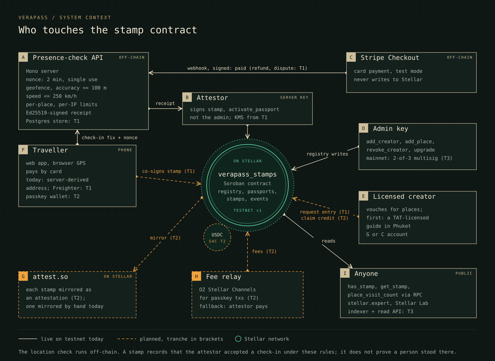
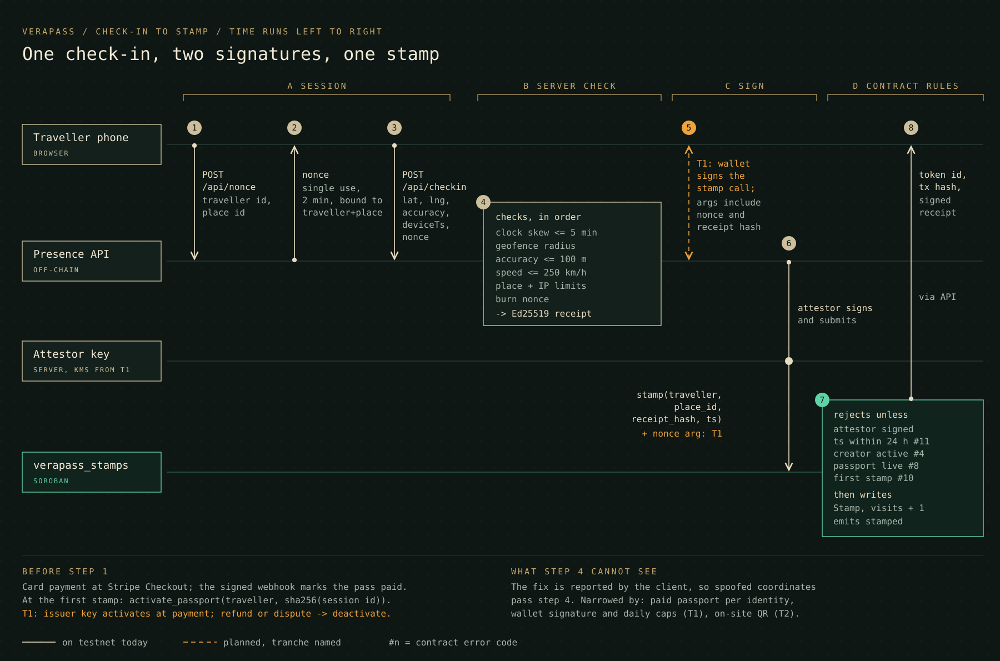
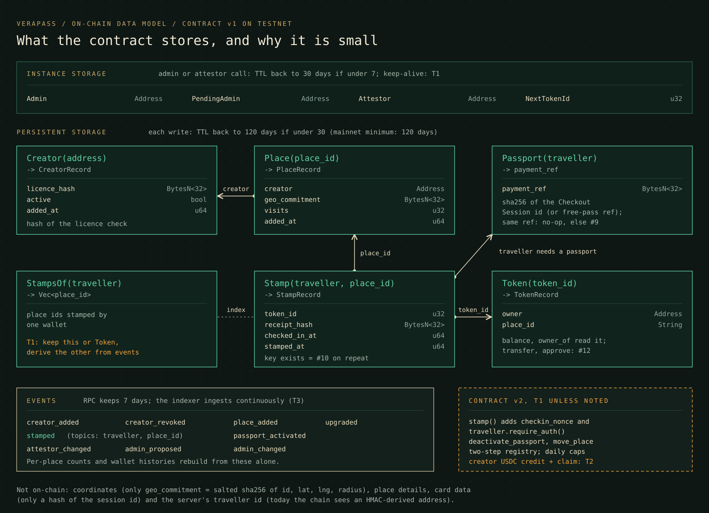

# Verapass

Proof-of-presence stamps on Soroban. Places are published by a licensed person through an on-chain registry, and a check-in becomes a non-transferable stamp only after the server's on-site checks accept it. GPS can be spoofed, so a stamp means "the published checks passed", not "this person stood here": see the [threat model](docs/threat-model.md).

Docs: [docs hub](docs/README.md) | [architecture](docs/architecture.md) | [threat model](docs/threat-model.md) | [test plan](docs/test-plan.md) | [UI and flows](docs/ui.md) | [contract reference](contracts/README.md) and [testnet deployment](contracts/DEPLOYMENT.md) | [contract on stellar.expert](https://stellar.expert/explorer/testnet/contract/CDIVZILQLADI72TXKQEGBZO7V6624VTBFUNF6UXUD337G6WTOUEKEZ65) | [license: Apache-2.0](LICENSE)

AI can now fake a travel influencer, a review and a photo of a beach that does not exist. Verapass starts from the other end: a licensed person vouches for each place, and each counted visit passed an on-site check under published rules (one-time code, geofence, accuracy cap, time window, speed check). Anyone can read the registry, the stamps and the per-place counts from the contract without our database.

The pilot is Phuket, with Sukanya as the flagship verified creator: a licensed Tourism Authority of Thailand guide with more than five years of guiding, brand "Thailand with Sukanya", author of the eBook "Phuket Without the Tourist Traps".

Team: Irvidas Bulotas (ex-Google engineer, full-time dev) and Zygimantas Bagdzevicius (ex-Amazon engineer, fractional CTO).

## Docs

- [Docs hub](docs/README.md): start here
- [Architecture](docs/architecture.md), [threat model](docs/threat-model.md) (v0 outline), [test plan](docs/test-plan.md) and [UI and flows](docs/ui.md) (screenshots of every screen)
- For developers: [quickstart](docs/quickstart.md), [contract interface](docs/contract-interface.md), [API reference](docs/api-reference.md), [verify a receipt](docs/verify-a-receipt.md), [integration guide](docs/integration-guide.md)
- [Security policy](SECURITY.md): how to report a vulnerability
- [LICENSE](LICENSE): Apache-2.0

## Architecture

The full technical design, complete on its own, is [docs/architecture.md](docs/architecture.md): system context, check-in to stamp, the contract interface with every signature, storage and TTLs, the on-chain and off-chain split, payments, wallets and fees, keys and roles, attest.so composability, failure modes, a threat summary and the delivery plan with budget and completion checks per deliverable. The three diagrams below are its core; a fourth, [data flow and trust boundaries](docs/diagrams/trust-boundaries.svg), is in the architecture page and the [threat model](docs/threat-model.md#3-trust-boundaries-and-actors).

### System context



Solid lines run on testnet today; dashed lines are planned, with the tranche in brackets. Stripe never writes to Stellar: the server turns a verified payment into a Soroban call. Only the attestor key can mint, and it cannot change the registry or upgrade the contract; the admin key does that.

### One check-in, two signatures, one stamp



Today the attestor alone signs `stamp`; step 5, the traveller's wallet co-signing the same call with the nonce and receipt hash in its arguments, is contract v2 (T1). The passport is activated lazily before the first stamp. The numbered steps are spelled out in [docs/architecture.md, section 2](docs/architecture.md#2-check-in-to-stamp) and in "Check-in flow" below.

### On-chain and off-chain



| Data | On chain | Off chain |
|---|---|---|
| Creator | address, hash of the licence check, active flag | the licence document and the check itself |
| Place | id, creator, salted `geo_commitment`, visit count | coordinates, radius, name, photos, tips (hidden places: server only) |
| Passport | traveller address, `payment_ref` (sha256 of the Checkout Session id, or a free-passport ref) | card data, session id, email |
| Stamp | traveller address, place id, receipt hash, check-in time, token id | the proof preimage (pseudonym, nonce, position, accuracy, times), kept by the traveller |

The location check runs off chain on what the phone reports. Only hashes go on chain. Fees per transaction on testnet are recorded in [contracts/DEPLOYMENT.md](contracts/DEPLOYMENT.md#fees) (about 0.66 XLM per stamp, 0.17 XLM per passport activation, all paid by the attestor).

### Code map

```
src/            React 19 + TypeScript app (Vite)
  sections/     One component per page section
  components/   Nav, passport dock, stamp, line icons, <Picture> (AVIF/WebP srcset)
  motion/       GSAP (ScrollTrigger, SplitText, DrawSVG, MotionPath, ScrambleText), Lenis, cursor,
                stamp-press section wipes, reveal-on-focus
  lib/          API client, traveller session, check-in flow and attestation polling, passport store
                (useSyncExternalStore over localStorage), hidden-place store, stamp verification
  pages/        /success and /cancel after Stripe Checkout, /verify, not found
server/         Hono API on Node (tsx)
  app.ts        Routes: /api/health, /api/traveller, /api/nonce, /api/checkin, /api/attestation/:hash,
                /api/checkout, /api/webhook, /api/pass/:id, /api/places/hidden. Security headers,
                body limits, per-IP rate limits
  config.ts     loadConfig(env): parsing, defaults and the production self-check
  identity.ts   HMAC-signed traveller ids and the pseudonym that receipts carry
  bootstrap.ts  Builds the app from the environment for Node and Vercel; picks the state backend
  store.ts      Store interface and an in-memory implementation with TTL and size cap
  redisStore.ts The same Store interface over a Redis-compatible REST endpoint (Upstash protocol), shared by all instances
  rateLimit.ts  Sliding-window rate limiter
  nonce.ts      Single-use nonces bound to (traveller, place), 2-minute window, clock-skew check
  velocity.ts   Rejects trips faster than 250 km/h between two real check-ins
  receipts.ts   Ed25519 signing and sha256 proof hashes
  attestor.ts   Attestor interface: MockAttestor and StellarContractAttestor (Soroban stamp contract)
  attestations.ts  Background queue: one attestation at a time, retries, status per proof hash
  places.ts     Hidden place details (server only)
  static.ts     Serves dist/ with real 404s
shared/         Used by both the app and the server
  places.ts     The one list of places: public summaries, public details
  geo.ts        Haversine distance, geofence check, nearest place
  checkin.ts    Wire types and canonical JSON
  verify.ts     Stamp verification with WebCrypto (browser and Node)
  pricing.ts    The Phuket pass product and price formatting
  routes.ts     The app's pages
scripts/        optimise-images.sh: AVIF and WebP copies in 480/750/1000 px and src/data/images.ts
contracts/      verapass_stamps Soroban contract (Rust), deploy script, testnet deployment record
tests/          unit/ and integration/ (Vitest), live/ (opt-in testnet), e2e/ (Playwright)
```

### Check-in flow

1. The browser asks `POST /api/nonce` for a one-time code bound to its traveller id and the place. It expires after 2 minutes. Hidden places need a paid pass.
2. The browser reads the Geolocation API (HTTPS and permission needed) and sends `POST /api/checkin` with the fix, its accuracy and the device time.
3. The server checks, in order: input shape and body size, traveller id signature, simulation setting, place (and pass for hidden places), device clock within 5 minutes, geofence (haversine distance inside the place radius), accuracy of 100 m or better, travel speed since the last real check-in, a per-place cap, then burns the nonce. A rejected fix does not burn the nonce, so the traveller can retry inside the window; a used nonce cannot be replayed.
4. A real check-in takes a per-traveller lock (in memory, or in the shared store across instances), reads the last fix, burns the nonce and records the new fix before releasing it, so two check-ins sent at the same moment, to one instance or two, cannot both pass the speed check against the same old fix.
5. The server builds a receipt with a sha256 proof hash of the full proof, signs it with Ed25519, and queues the on-chain record. It answers 200 with the signed record when Stellar confirms within a few seconds, or 202 with `{ status: "pending" }`; the browser then polls `GET /api/attestation/:proofHash`. The confirmed record (tx id and link) is signed together with the proof hash. Only the hash goes on chain; the raw location stays off chain, with the traveller.

### What the server can and cannot prove

Browser GPS is asserted by the client. A script can send each place its own coordinates, and developer tools or mock-location apps can do the same. The server does not make that impossible, and the test suite says so: `tests/integration/attacks.test.ts` lists each attack, with the ones not defended yet written as `it.fails`.

The [threat model](docs/threat-model.md) lists every attack with its status today and the tranche that closes it. What the server does today is defence in depth: one-time codes that expire in 2 minutes, a 100 m accuracy floor, a 250 km/h travel-speed check per traveller id, traveller ids that only the server can issue (and only so many per IP per hour), per-IP limits on every route, and a per-place cap. That makes faking slow and visible. It does not stop someone with many connections and fresh ids. The real anti-spoofing layers are next: a rotating on-site code (an HMAC of a place secret and the time slot, shown on a sign or by the guide) and check-ins signed by the traveller's own wallet.

### Verify a stamp

`/verify` checks a stamp in the browser, without asking the Verapass database: it recomputes the proof hash from the preimage, compares it with the receipt, checks the Ed25519 signatures on the receipt and on the Stellar record, and compares the signing key with the one the server publishes at `/api/health`. Each passport stamp has a "Check this stamp" link that opens it there (the stamp travels in the URL fragment, which is never sent to a server). The same code is in `shared/verify.ts` for anyone who wants to run it themselves.

### Stripe

- `POST /api/checkout` needs a valid traveller id. It creates a Checkout Session in `mode: "payment"` with the price inline (`price_data`, $19 launch price from the original landing page, still to be confirmed by the founders) and `client_reference_id` set to the traveller id.
- `POST /api/webhook` verifies the `Stripe-Signature` header against the raw body with `STRIPE_WEBHOOK_SECRET` (bodies over 64 KB are refused). On `checkout.session.completed` or `checkout.session.async_payment_succeeded` with `payment_status: "paid"` it marks the pass as paid for that traveller, once per session id.
- `GET /api/pass/:id` falls back to `stripe.checkout.sessions.retrieve` when the webhook has not arrived (or the server restarted), so a missed webhook does not leave a paid traveller locked out. A pass only opens for the traveller who paid.
- The success page never unlocks anything from the URL alone.
- Stripe moves money only. It does not call Soroban contracts or write attestations, so the on-chain record is always written by the Verapass server.
- Paying guides: a per-stamp USDC credit on Stellar, computed and paid by the stamp contract from a funded pool and claimed by the guide to her own account (planned grant work: testnet in T2, mainnet in T3; see [docs/architecture.md](docs/architecture.md#5-payments)). Stripe Connect is not the route: self-serve cross-border payouts do not cover Thailand.

### Stellar

- `StellarContractAttestor` (used when `STELLAR_SECRET` and `VERAPASS_CONTRACT_ID` are set) calls the `verapass_stamps` contract with `@stellar/stellar-sdk`: build the contract call, simulate it on the RPC, assemble it with the simulated footprint and resource fee, sign with the attestor key, send, and poll `getTransaction` until it succeeds. The stamp call is `stamp(traveller, place_id, checkin_receipt_hash, ts)`: the receipt's proof hash as 32 bytes and the check-in time in unix seconds. The returned token id, the tx hash and stellar.expert links for the tx and the contract go into the signed record.
- The traveller has no wallet yet, so the server derives a pseudonymous Stellar address per traveller id with an HMAC keyed by `TRAVELLER_SECRET`. Nobody signs with it; the chain never sees the traveller id.
- The contract only stamps for an active passport. When simulation answers `PassportNotActive`, the attestor first calls `activate_passport` with `payment_ref` = sha256 of the traveller's Checkout Session id. A traveller who checks in at a free place before paying gets a free-passport ref (sha256 of `verapass-free-passport-v1|<address>`) instead.
- One stamp per traveller and place: a repeat visit does not mint again. The attestor reads `get_stamp` and returns the existing token, marked "already on Stellar from an earlier visit", with no transaction of its own.
- Contract refusals (unknown place, revoked creator, bad timestamp) fail the attestation at once; network errors are retried. Transactions go out one at a time with a locally tracked sequence number; `TRY_AGAIN_LATER` is resent with backoff and `DUPLICATE` is treated as already queued.
- Simulated (demo) visits always get a mock record and never reach the chain.
- The server pays the fees, so travellers need no wallet and no XLM.

## Run it

Needs Node 22.12 or newer.

```bash
npm install
npm run dev          # web on http://localhost:5173, API on http://localhost:8787
```

With no `.env` file everything runs in demo mode (see below), so the page works out of the box.

| Script | What it does |
|--------|--------------|
| `npm run dev` | Vite dev server and the API together (Vite proxies `/api` to the API) |
| `npm run build` | Type-checks, then builds the web app into `dist/` |
| `npm run preview` | Serves the production build on :4173 plus the API |
| `npm start` | API only (`SERVE_STATIC=true` also serves `dist/`) |
| `npm test` | Unit and integration tests (Vitest). The live testnet test is skipped |
| `npm run test:live` | Opt-in test against the real testnet contract: activates a passport and mints one stamp for a fresh random traveller. Needs `STELLAR_SECRET` and `VERAPASS_CONTRACT_ID` (environment or `.env`); skipped without them |
| `npm run test:e2e` | End-to-end tests (Playwright, Chromium): user flows, an axe accessibility gate at 1440 and 390 px, a keyboard walk, print, link previews and a check that the bundle holds no hidden-place details. Builds the app and starts its own servers on ports 4179 and 8797, always in demo mode |
| `npm run lint` | ESLint (flat config, typescript-eslint strict, react-hooks, jsx-a11y) |
| `npm run typecheck` | `tsc -b` over the app, the server, shared code and tests |

First e2e run on a new machine: `npx playwright install chromium`.

What each suite covers, the current counts and what is not tested yet: [docs/test-plan.md](docs/test-plan.md). A step-by-step walk-through with expected output: [docs/quickstart.md](docs/quickstart.md).

## Environment variables

Copy `.env.example` to `.env`. Never commit real keys; `.env` is gitignored.

| Variable | Default | Meaning |
|----------|---------|---------|
| `STRIPE_SECRET_KEY` | empty | Stripe test key (`sk_test_...`). Empty means checkout demo mode. Live keys (`sk_live_...`) are refused at startup. |
| `STRIPE_WEBHOOK_SECRET` | empty | `whsec_...` from `stripe listen --forward-to localhost:8787/api/webhook`. Without it the webhook route answers 400 and passes unlock only through the Checkout Session lookup (a warning is logged at startup). |
| `STELLAR_SECRET` | empty | The contract's attestor key (`S...`, testnet, funded with Friendbot). Only this key can call `stamp` and `activate_passport`; it cannot change the registry. Malformed keys are refused at startup. |
| `VERAPASS_CONTRACT_ID` | empty | The `verapass_stamps` contract id (`C...`). The current testnet deployment is in `contracts/DEPLOYMENT.md`. Live stamping needs both this and `STELLAR_SECRET`; with only one of them the server logs a warning and runs the mock attestor. |
| `STELLAR_RPC_URL` | `https://soroban-testnet.stellar.org` | Soroban RPC endpoint. Testnet only: transactions use the testnet passphrase and links point to stellar.expert testnet. |
| `RECEIPT_SIGNING_KEY` | empty | Ed25519 PKCS#8 PEM (use `\n` for newlines). Empty means a new key per server start, so older stamps stop verifying. Other key types are refused. |
| `TRAVELLER_SECRET` | random | HMAC key (16+ characters) for the traveller ids the server issues. It also derives each traveller's Stellar address on the contract. Empty means a random key per start: ids, passes bound to them and the derived addresses all change after a restart. |
| `ALLOW_SIMULATED_CHECKINS` | `true` locally | `true` or `false`. If unset it is on only when there is no `STELLAR_SECRET` and `NODE_ENV` is not `production`. Simulated visits are never written on chain either way. |
| `NODE_ENV` | empty | `production` makes the server refuse to start without `RECEIPT_SIGNING_KEY`, `TRAVELLER_SECRET`, an explicit `ALLOW_SIMULATED_CHECKINS`, and `STRIPE_WEBHOOK_SECRET` when Stripe is on. |
| `RATE_LIMIT_TRAVELLER_PER_HOUR` | `30` | New traveller ids per IP per hour. |
| `RATE_LIMIT_API_PER_MINUTE` | `60` | Nonce, check-in, checkout and pass calls per IP per minute, per route. |
| `RATE_LIMIT_PLACE_PER_MINUTE` | `120` | Real check-ins per place per minute, across everyone. |
| `TRUST_PROXY` | `false` | `true` reads the client IP from `X-Forwarded-For`. Only behind a proxy you control; otherwise anyone can pick their own IP. |
| `PUBLIC_ORIGIN` | `http://localhost:5173` | Where Stripe sends travellers back. Localhost origins are also allowed for local runs. |
| `PORT` | `8787` | API port. |
| `SERVE_STATIC` | `false` | `true` also serves `dist/`: the app's pages with 200, any other path with 404. |
| `API_PORT` | `8787` | Read by `vite.config.ts`: the port the `/api` proxy points to. |
| `SITE_URL` | empty | Read at build time. Makes the Open Graph image and canonical URL absolute and adds `sitemap.xml`. Set it for any public deployment, or link previews show no image. |

## Demo mode

The page is built so judges can try everything without keys, and it says so on screen.

- Passport id: on the first call that needs one, the browser asks `POST /api/traveller` for a server-issued, HMAC-signed id (`trav_<16 hex>.<tag>`). The server refuses ids it did not issue. The id holds the browser's pass, so receipts and stamp links never carry it: they carry a pseudonym (`anon_<32 hex>`) that the server refuses wherever an id is expected.
- Checkout: with no `STRIPE_SECRET_KEY`, `POST /api/checkout` returns `{ mode: "demo" }` and a `/success?session_id=demo_...` URL. The server records the demo pass as paid for that traveller only. The success page confirms it through `GET /api/pass/:id?traveller=...`; opened in another browser, the same link says the pass belongs to another passport.
- Hidden places: their names, coordinates and tips are not in the web bundle (they live in `server/places.ts`). `GET /api/places/hidden` hands them out only to a traveller with a paid pass, and `/api/nonce` and `/api/checkin` refuse hidden places without one. Editing the pass flag in `localStorage` unlocks nothing.
- Check-in: "Demo: simulate being here" sends a fix a few metres from the place. It goes through the same server checks as a real fix (nonce, time window, geofence, accuracy), skips only the travel-speed check, and the receipt and stamp are marked "simulated". Simulated visits always get a mock attestation, even when `STELLAR_SECRET` is set.
- Attestation: without both `STELLAR_SECRET` and `VERAPASS_CONTRACT_ID`, stamps get a deterministic mock attestation (`mock-...` id). The page says the server is in mock mode and the passport shows "Mock tx ..., not on chain" instead of an explorer link. See "Live mode" below for real stamps.
- The passport lives in this browser's `localStorage` (key `verapass:passport:v2`). Each stamp keeps its signed receipt, the proof preimage and the signed Stellar record, and the browser checks them against the server's published key: an edited stamp shows "Does not verify" and does not count. "Reset demo passport" clears the stamps.

## Live mode (stamps on Stellar testnet)

The `verapass_stamps` contract is deployed on testnet (id, transactions and keys in `contracts/DEPLOYMENT.md`). To have real check-ins minted as stamps on it:

1. Get the attestor secret from the CLI keystore of the machine that deployed: `contracts/.tools/bin/stellar keys secret verapass-attestor`. It is the attestor key, not the admin key (`verapass-admin`), which the server never needs.
2. In `.env` set `STELLAR_SECRET` to it, `VERAPASS_CONTRACT_ID=CDIVZILQLADI72TXKQEGBZO7V6624VTBFUNF6UXUD337G6WTOUEKEZ65`, and a fixed `TRAVELLER_SECRET`.
3. `npm run dev`. The startup line says `attestation: testnet contract C...` and simulated check-ins default to off.
4. Check in at a place for real (on site, or with the browser's location override set to the place). The passport shows "Stamp #N on Stellar testnet: tx ..." linking to the transaction on stellar.expert, and `/verify` links the token on the contract.

To run one live server for a pilot with real guests (HTTPS, systemd or a tunnel, a preflight check of every setting), follow [docs/pilot-server.md](docs/pilot-server.md).

`npm run test:live` checks the same path from the command line. After a testnet reset (next one 2026-12-16) redeploy with `contracts/scripts/deploy-testnet.sh` and update `VERAPASS_CONTRACT_ID`.

With a Stripe test key: run `stripe listen --forward-to localhost:8787/api/webhook`, put the printed `whsec_...` in `.env`, and pay with card 4242 4242 4242 4242, any future date, any CVC.

## Deploy (Vercel)

Live demo: https://verapass.vercel.app (project `verapass`, demo payments, mock attestation).

- The web app is the Vite build in `dist/`. `api/index.ts` runs the same Hono app as `server/index.ts` (both use `server/bootstrap.ts`) as one Vercel function; `vercel.json` sends every `/api/*` path to it and serves `/success`, `/cancel` and `/verify` from `index.html`.
- Production env vars set in the Vercel project: `RECEIPT_SIGNING_KEY`, `TRAVELLER_SECRET` (both sensitive), `ALLOW_SIMULATED_CHECKINS=true`, `TRUST_PROXY=true`, `PUBLIC_ORIGIN` and `SITE_URL` (`https://verapass.vercel.app`).
- Server files use `.js` on relative imports because Vercel runs them as plain Node ES modules.
- Deploy: `vercel deploy --prod`.

Shared state. Vercel may answer each request from a different instance, so server state (check-in nonces, passes, last fixes for the speed check, rate-limit counts, attestation status) needs a store all instances can reach. Set these to use a Redis-compatible REST endpoint (the Upstash REST protocol; Vercel's Redis integration from the Marketplace provides one):

| Variable | Meaning |
| --- | --- |
| `VERAPASS_REDIS_REST_URL` | REST endpoint, `https://...` (plain `http` only for `localhost`) |
| `VERAPASS_REDIS_REST_TOKEN` | Its token, sent as `Authorization: Bearer`. Mark it sensitive in Vercel. |
| `VERAPASS_REDIS_PREFIX` | Optional key prefix, default `verapass:`. Use another one per environment (for example `verapass-preview:`) when previews share the database. |

- If the `VERAPASS_` pair is not set, the server also accepts the pairs the integrations add on their own: `UPSTASH_REDIS_REST_URL` / `UPSTASH_REDIS_REST_TOKEN`, then `KV_REST_API_URL` / `KV_REST_API_TOKEN`.
- `server/redisStore.ts` talks to the endpoint with `fetch` only (no client library). Every key has a time-to-live; nonces are burnt with `SET NX`, so a nonce is accepted once even when two instances race; counters use `MULTI/EXEC`. The per-traveller check-in lock holds a random owner id and is released with a compare-and-delete `EVAL` script, so a check-in that outlives its lock never frees someone else's.
- The client sends back the `upstash-sync-token` header (Upstash read-your-writes). On a database with read replicas, the check-in that takes a traveller's lock therefore reads the last fix the previous lock holder wrote, not an older copy. A nonce issued on one instance and read on another a moment later can still miss a lagging replica and answer `nonce-unknown` (the user retries); a single-region database avoids that.
- Paste the REST URL and token, not the `redis://` / `rediss://` connection string. The server refuses a non-https URL or a URL with credentials in it, and never repeats the value in the error.
- The store tests run against the in-memory store, a fake REST endpoint and a fake with a lagging read replica. To run the same contract tests against a real endpoint (an Upstash database, or a local `serverless-redis-http` container in front of Redis), set `VERAPASS_TEST_REDIS_REST_URL` and `VERAPASS_TEST_REDIS_REST_TOKEN` for `npm test`. Each run uses its own random key prefix and every key expires.
- Each store request has a 5 second timeout. A store failure answers 503 and never lets a check-in through: a nonce that could not be burnt stays unused and can be retried.
- Without these variables state stays in memory, which is right for local dev, tests and a single Node server. On Vercel (`VERCEL` is set) the function then logs a warning at startup and keeps serving, with the old limit: after the demo checkout the hidden places can stay locked, and a check-in can fail with an unknown nonce.
- `GET /api/health` reports `"state": "redis"` or `"memory"`, and the startup log names the variable pair in use (never its value). If the store cannot be reached, API calls answer 503 with `"error": "state-unavailable"` until it is back.

## Motion and accessibility

- The hero is the intro: frame one is an over-processed "AI feed post" of a real photo. On a pointer device the cursor is a loupe that shows the real photo under the filter; then a scan line passes, the three checks tick and the VERIFIED HUMAN stamp lands. On phones the card comes first and the scan plays straight away.
- The stamp is the transition: at three handoffs (problem to Sukanya, how it works to the map, pricing to guides) the next section is pressed on as a growing circle, scrubbed by scroll.
- The check-in is a camera move: the map zooms to the pin, the geofence draws on, footsteps lead into it, the stamp slams with a two-frame flash, the camera pulls back and the stamp arcs into the passport dock.
- Also: a pinned evidence row that fits the screen, a pinned stack for the seven promises, one continuous route with a traveller through the how-it-works steps, a fingerprint-like contour read over Sukanya's portrait and a signature that writes itself, passport pages that turn in, stamps that tilt under the pointer and proof hashes that type out.
- `prefers-reduced-motion: reduce` turns all of that into plain fades with all content shown at once: no smooth scroll, no cursor, no pinning, no wipes. The e2e suite checks that every heading ends fully visible in this mode.
- Scroll reveals animate opacity, not visibility, so content stays in the accessibility tree; keyboard focus finishes any pending reveal, and the pinned evidence row moves to the focused card.
- Semantic landmarks, a skip link, a nav that shows itself when it holds focus, a mobile menu that keeps focus inside and stops the page behind it, map pins as a pointer shortcut with the place list as the keyboard path, two-tone focus rings that meet 3:1, print styles that show every block. An axe gate and a keyboard walk run in the e2e suite.
- Performance: self-hosted, ASCII-subset variable fonts with metric-matched fallbacks (desktop CLS 0.13 to 0 in local measurement), photos as AVIF and WebP in several widths with intrinsic sizes, the hero image preloaded.
- Mobile first. The e2e suite checks there is no horizontal overflow at 375 px.

## Known gaps

- Testnet only. The contract's creator is a placeholder address, not Sukanya's own wallet (see `contracts/DEPLOYMENT.md`).
- Passports are activated lazily, at the first real stamp, not from the Stripe webhook yet. The contract keeps one `payment_ref` per passport, so a traveller who stamps a free place before paying keeps the free-passport ref; the later payment is not recorded on chain.
- Traveller addresses are derived by the server. Passkey wallets owned by the traveller are on the roadmap.
- No rotating on-site code and no wallet-signed check-ins yet, so a script with many connections can still collect places (see "What the server can and cannot prove").
- No creator verification flow in the app. Sukanya's licence check is described, not implemented. The guide's pay is planned as a USDC credit from the contract (see Stripe above); nothing pays a guide today.
- Server state (nonces, last fixes, passes, rate limits, attestation status) sits behind a `Store` interface with TTLs. Without the Redis REST variables it is in memory: one instance only, reset on restart (passes paid through Stripe come back through the Checkout Session lookup). With them it is shared through a Redis REST store; whether the live demo has one configured is shown by `GET /api/health` (`"state"`).
- The passport is per browser (`localStorage`). There is no account or on-chain wallet for the traveller yet; a passkey wallet is on the roadmap.
- The home page is rendered in the browser. Without JavaScript it shows a short static summary; full prerendering is not set up.
- Sukanya's licence photo is not on the site yet. The portrait and the "at work" photo reuse photos already in the project; a dedicated portrait would be better.
- Place coordinates and geofence radii are approximate public locations. Sukanya has to confirm each check-in point.
- The $19 price comes from the original landing page and is not confirmed.

## Related documents

- [docs/README.md](docs/README.md) - the docs hub: quickstart, integration guide, contract interface, API reference, receipt verification
- [docs/architecture.md](docs/architecture.md) - architecture and delivery plan, with diagrams
- [docs/threat-model.md](docs/threat-model.md) - what a stamp does and does not prove, attacks and their status
- [docs/test-plan.md](docs/test-plan.md) - test suites, counts and gaps
- [docs/ui.md](docs/ui.md) - screenshots of every screen and what each one does
- [SECURITY.md](SECURITY.md) - reporting a vulnerability
- [contracts/README.md](contracts/README.md) and [contracts/DEPLOYMENT.md](contracts/DEPLOYMENT.md) - the Soroban contract and every testnet transaction
- `research/` - sourced research on the market and the Stripe + Stellar wiring (the wiring note is partly superseded; see its header)
- `source/` - Phuket stats and the original landing page
- The SCF grant case, pitch deck and SCF round notes are internal working files and are not in the public repository (see `.gitignore`).

## Security

Report vulnerabilities privately through GitHub's private vulnerability reporting (Security tab, "Report a vulnerability"), not in a public issue. Scope and response times are in [SECURITY.md](SECURITY.md); what a stamp does and does not prove is in the [threat model](docs/threat-model.md).

## Maintenance

The two founders maintain the contract, the SDK, the protocol spec and the docs during the grant and for 12 months after the mainnet launch, funded by the founders and not by the grant. Issues get a first answer within 5 working days. After each testnet reset the contract is redeployed within a day and the new id is published in `contracts/DEPLOYMENT.md` and the docs.
<!-- [FOUNDER: confirm the maintenance terms above; they match the SCF form text.] -->

## AI disclosure

This repository's code (Soroban contract and tests, check-in API, attestor, Stripe integration, web app), its documentation and the diagrams were written with AI assistance (Claude) and reviewed by the founders.
<!-- [FOUNDER: confirm the review before publishing.] -->

## License

Apache-2.0. See [LICENSE](LICENSE).
