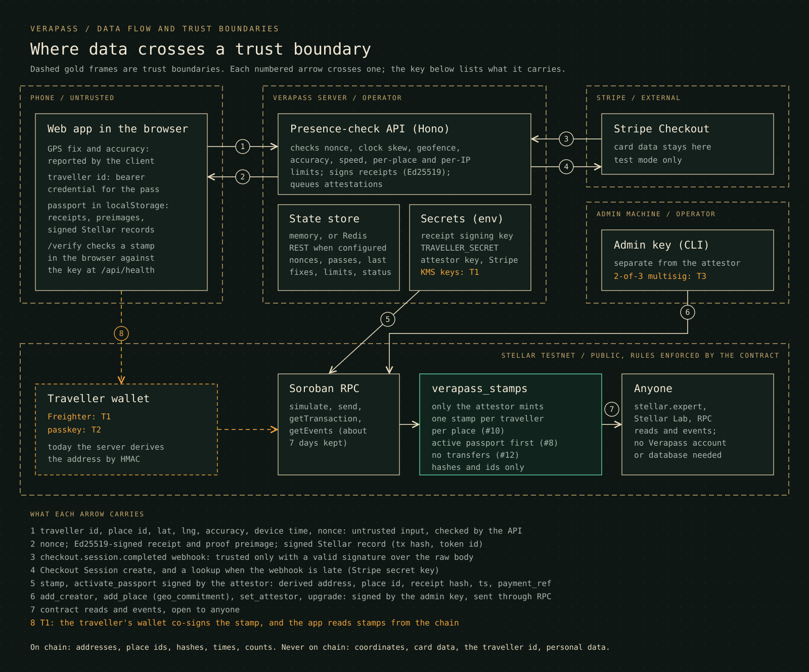

# Threat model outline (v0)

Status: outline, written against the code in this repository on 2026-10-10 (contract v1 on Stellar testnet, presence-check API, demo web app). It says what an attacker can do today, which defences exist, which do not, and which tranche closes each gap. A full STRIDE threat model v1 for contract v2 (attestor, issuer, admin, creator, traveller and relayer, extended to passkeys, the USDC credit and booking passports, with the check-in protocol spec v1 and a monitoring plan) is planned work for T2. It replaces this outline; the outline itself is pre-grant work. Last updated 2026-10-10 (T-5, T-20 and T-23 after the shared-store and receipt changes).

Related pages: [architecture](architecture.md), [test plan](test-plan.md).

## 1. What we claim and what we do not

A stamp means: the Verapass attestor accepted a check-in whose client-reported position was inside the place's geofence, under nonce, time and speed limits, for a traveller with an active passport. From T1 it also means the traveller's own wallet approved the stamp.

A stamp does not mean "this person stood here". The location check runs off-chain on numbers the phone reports, and browser GPS can be faked with developer tools, mock-location apps or a plain script. The defences below make faking slower, paid per identity and visible. They do not make it impossible, and two attacks that work today are kept in the test suite as expected failures (section 4).

## 2. Assets

| Asset | Why it matters |
|---|---|
| Per-place visit counts and stamps | the public signal readers rely on; inflating them is the main incentive to attack |
| Creator registry | who is allowed to vouch for places; a fake creator could publish fake places |
| Creator USDC credit (T2+) | real money paid per stamp from a funded pool |
| Attestor, issuer and admin keys | each one can write a different part of the contract state |
| Receipt signing key | makes off-chain receipts and confirmed records verifiable |
| Traveller HMAC secret | issues traveller ids, derives traveller addresses and receipt pseudonyms |
| Traveller id | the browser's session: it holds the paid pass and is accepted by every route, so whoever has it can act as that traveller |
| Geo salt | keeps hidden places' coordinates out of their on-chain commitments |
| Hidden place details | the paid content; server only |
| Traveller visit history | privacy of where a wallet has been |

## 3. Trust boundaries and actors

- Phone browser to API: everything the phone sends (position, accuracy, device time) is untrusted input.
- API to chain: the contract enforces its own rules whatever the server does (who may mint, one stamp per traveller per place, an active passport first, no transfers, revoked creators frozen). It cannot check where a phone was.
- Stripe to API: only webhooks with a valid signature over the raw body are trusted.
- Readers to chain: counts come from contract reads and events, not from our database.

| Actor | Goal | Capability today |
|---|---|---|
| Casual cheater | collect stamps without travelling | developer tools or a mock-location app on one phone |
| Scripted farmer | inflate a place's count or collect many places | scripts, many IPs, fresh traveller ids |
| Dishonest creator (T2+) | farm her own USDC credit | buys passes or invents bookings, controls her own devices |
| Colluding guide or bystander | relay on-site proof to someone remote | physically on site |
| Server attacker | mint at will | steals the attestor key or the whole server environment |
| Curious reader | learn where a wallet has been, or where a hidden place is | public chain data |

## 4. Threats and current status

Status key: DEFENDED (a test refuses it today), PARTIAL (narrowed, not stopped), OPEN (works today), PLANNED (the defence is a named tranche item).

| # | Threat | Status today | Defence today | Planned |
|---|---|---|---|---|
| T-1 | Spoofed coordinates far from the place | DEFENDED | geofence check, 100 m accuracy floor | - |
| T-2 | A script sends each place its own coordinates | OPEN (expected-fail test) | speed check limits one identity to one place per plausible travel time; per-IP and per-place limits | rotating on-site QR at high-value places (T2); wallet-signed stamps (T1) |
| T-3 | A fresh traveller id per place, from different connections | OPEN (expected-fail test) | traveller ids only from the server, capped per IP per hour | wallet-signed stamps (T1), paid passport per identity (T1), daily caps (T1) |
| T-4 | Replay of an old check-in | DEFENDED | single-use nonce, 2-minute window, bound to traveller and place; clock skew within 5 minutes | nonce inside the traveller's signature (T1) |
| T-5 | Two check-ins at the same moment to dodge the speed check | DEFENDED | a per-traveller lock around the speed check, nonce burn and fix update; shared across instances with the Redis REST store (tested with two instances and with a lagging read replica) | - |
| T-6 | Made-up or tampered traveller ids | DEFENDED | HMAC-signed ids; unknown ids get 401 | traveller wallets (T1, T2) |
| T-7 | Rotating ids or flooding from one connection | DEFENDED | per-IP limits on every route, per-place cap across travellers | per-address limit (T2) |
| T-8 | Collecting hidden places without paying | DEFENDED | hidden-place nonces need a paid pass; hidden details never ship in the web bundle | - |
| T-9 | Demo (simulated) check-ins reaching the chain | DEFENDED | simulated visits always get a labelled mock record; simulation is off by default once a chain key is set | - |
| T-10 | Edited stamp in browser storage, or a swapped transaction link | DEFENDED | receipts and confirmed records are Ed25519-signed; `/verify` recomputes the proof hash and checks both signatures | the app reads stamps from the contract (T1) |
| T-11 | Forged Stripe webhook marks a pass as paid | DEFENDED | signature verified over the raw body; body size cap; success link alone unlocks nothing | refunds and disputes deactivate the passport (T1) |
| T-12 | Free passports: today a free-place check-in activates a passport, so the contract cannot tell paid from free | OPEN | none on-chain | issuer-only activation at payment time; free check-ins stop creating passports (T1) |
| T-13 | Many funded identities, one place each | PARTIAL | per-place cap, per-IP limits | paid or booking passport per identity, daily caps, stamps split by passport source (T1, T3) |
| T-14 | Creator buys passes or invents bookings to farm her own credit | n/a until T2 | - | booking passports need a seat claim signed by the traveller's own wallet, 20 per creator per day, stamped only at her own places, per-place daily credit cap, credit from the founder pilot pool, published card/booking split and reconciliation report (T2, T3). A creator who also creates the traveller wallets is bounded by the caps, not stopped |
| T-15 | Someone on site relays the QR code live, or a guide colludes | n/a until T2 | - | not stopped by QR; bounded by caps and visible in per-place patterns. Stated as a limit |
| T-16 | Mock-location apps on a real phone at scale | OPEN | none beyond the checks above | native app with device attestation: out of scope for this grant |
| T-17 | Attestor key stolen | OPEN | admin can rotate with `set_attestor`; admin and attestor are separate, so the attestor cannot change the registry or upgrade | KMS key, mint-rate alert, traveller signature, separate issuer key, daily caps (T1) |
| T-18 | Admin key stolen | OPEN on testnet | separate from the attestor; two-step admin transfer | 2-of-3 multisig admin on mainnet (T3) |
| T-19 | Contract instance and code archived after an idle stretch, or a stamp entry archived | OPEN | the instance is topped up to 30 days by admin or attestor calls once under 7 days remain, persistent entries to 120 days on writes once under 30; on testnet the instance and code were extended by hand to about 2027-02-07 | keep-alive job and tested restore path (T1) |
| T-20 | Multiple API instances accept the same nonce, or lose state | PARTIAL | shared Redis REST store with an atomic nonce burn (`SET NX`), a per-traveller lock and fail-closed 503s, tested with two instances (built; on only when configured, otherwise state is per instance). Still open: state expires with its keys, and an attestation queued in a stopped instance's memory is lost | durable Postgres ledger and attestation outbox resumed by another instance (T1) |
| T-21 | Wrong client IP behind a proxy defeats per-IP limits | PARTIAL | `X-Forwarded-For` is only read when `TRUST_PROXY=true`, and then only its last entry, the one the proxy wrote, so a client cannot forge its address through a proxy that appends (test "a made-up first X-Forwarded-For entry does not buy a fresh per-IP budget"). Still open: a client that reaches Node directly, bypassing the proxy | - |
| T-22 | Denial of service on the API or RPC | PARTIAL | body size limits, rate limits, capped nonce store; 202 `pending` and a retry queue when RPC is slow | monitoring plan (T2), alerts (T3) |
| T-23 | A shared stamp link hands over the traveller's session: the receipt and preimage used to carry the raw traveller id, which every route accepts, so anyone given the link could use that traveller's paid pass and check in as them | DEFENDED since 2026-10-10 for new stamps | receipts and preimages carry `anon_<32 hex>`, an HMAC pseudonym the server refuses as an id; on-chain addresses are unchanged; test "a shared stamp link does not hand over the traveller's session or paid pass". Stamps made before that date still carry the id, so the passport no longer offers a share link for them (test "an older stamp with the raw traveller id gets no share link"); links already shared from them stay live until the id is replaced | traveller-held wallets replace the server-issued id (T1 Freighter, T2 passkeys) |

The two OPEN rows that are tests (T-2 and T-3) live in `tests/integration/attacks.test.ts` as `it.fails`. Each run of `npm test` reports them as expected failures, once per store backend (memory, a fake Redis REST store and the fake with a lagging read replica), so 6 in all. When a defence lands, the test starts passing as a normal test, `it.fails` then fails the run, and the case is switched to a plain `it`. Flipping both to refused is a T2 completion criterion.

## 5. Keys and secrets

Names are the environment variables the server and scripts read. No secret value is stored in this repository; `contracts/DEPLOYMENT.md` lists only public addresses of throwaway testnet identities.

| Secret | Held today | If leaked | Planned |
|---|---|---|---|
| `STELLAR_SECRET` (attestor) | server environment; testnet CLI keystore of the deploying machine | activate passports and mint stamps for any address; cannot change the registry or upgrade | stamp only; AWS KMS Ed25519 over the transaction hash; tested rotation; mint-rate alert (T1) |
| Admin key | testnet CLI keystore | registry writes, rotate the attestor, upgrade the contract | 2-of-3 multisig on mainnet (T3) |
| Passport issuer key | does not exist yet | (T1+) create and deactivate passports | its own KMS key and IAM permission, separate from the attestor (T1) |
| `RECEIPT_SIGNING_KEY` | server environment; a fresh key per process if unset | forge off-chain receipts and confirmed records that `/verify` accepts; cannot mint on-chain | rotation procedure and published key history (T2 spec) |
| `TRAVELLER_SECRET` | server environment; random per process if unset | issue valid traveller ids; link traveller ids to their on-chain addresses. The derived address keys are never used to sign today, and the v1 contract never asks the traveller to sign | traveller-held wallets replace derived addresses (T1 Freighter, T2 passkeys) |
| `VERAPASS_GEO_SALT` | outside the repository, with the deployer | hidden places' coordinates can be brute-forced from their on-chain commitments (section 7) | re-register hidden places with a new salt after any leak (`move_place`, T1) |
| `STRIPE_SECRET_KEY`, `STRIPE_WEBHOOK_SECRET` | server environment, test mode only; live keys are refused | create sessions; forge webhooks that mark passes as paid | issuer key activates on-chain only from a verified webhook (T1) |

The server refuses to start in production without the receipt key, the traveller secret, the webhook secret (when Stripe is on) and an explicit simulation setting. The web app never imports server code, and a test checks that.

## 6. What is and is not on chain

| On-chain (public) | Off-chain |
|---|---|
| Creator address, `licence_hash`, active flag | the licence document and the check |
| Place id, creator, `geo_commitment`, visit count | coordinates, radius, name, photos, tips |
| Passport: traveller address, `payment_ref` (sha256 of the Checkout Session id, or a free-passport ref) | card data, session id, email |
| Stamp: traveller address, place id, `checkin_receipt_hash`, check-in time, token id | the proof preimage: a pseudonym of the traveller id, nonce, lat, lng, accuracy, device and server time |
| Events: `stamped` with traveller and place id as topics, and the registry events | API logs, rate-limit state, nonces |

The receipt hash is sha256 over a preimage that includes a random server nonce, so the position inside it cannot be guessed from the hash.

## 7. Location privacy

Hidden places. Every place, hidden ones included, is registered on-chain with only its id and `geo_commitment` = sha256(`verapass-geo-v1|<id>|<lat>|<lng>|<radiusM>|<salt_hex>`). With a 32-byte random salt, the commitment says nothing about the location. Without the salt, the coordinate space of one island is small enough to search, so the salt is the whole defence. Hidden places stay hidden only while:

- the salt stays secret (it is never printed by the deploy script and must stay outside the repository);
- place ids do not describe the place (today's ids are short generic slugs; any id that names a landmark gives it away regardless of the salt);
- hidden details stay server-side (tests check that the web bundle and the shared module carry no hidden names, coordinates or tips).

Traveller visit history. A wallet's history (address, place id, time) is public through `stamped` events and contract reads. Today the address is derived from the traveller id with an HMAC, so nobody without the server secret can link it to a traveller id or a browser. From T1 travellers sign with their own wallets, so the history is tied to whatever else that wallet does on Stellar. Travellers are told before their first stamp that their visit history is public.

Shared stamps. A stamp link carries the proof preimage in the URL fragment so `/verify` can check it without our database. The fragment is not sent to any server, but it contains the position the phone reported. Anyone the traveller shares the link with sees that position. It does not contain the traveller id: since 2026-10-10 the receipt carries a pseudonym (T-23).

## 8. Mitigations by tranche

| Tranche | Security-relevant work |
|---|---|
| T1 (2027-02-05) | Two-party stamps (traveller and attestor sign one call, nonce in the signed arguments); separate passport-issuer key; `deactivate_passport` on refund or dispute; free check-ins stop creating passports; per-passport and contract-wide daily caps; two-step creator registry; `move_place`; durable Postgres check-in ledger and attestation outbox; attestor and issuer keys in AWS KMS with tested rotation; keep-alive job; tested restore path; mint-rate alert; the app reads stamps from the chain |
| T2 (2027-03-26) | Passkey wallets with fee relay quotas and a daily fee budget alert; rotating on-site QR (HMAC of a place secret and a 30 to 60 second slot); per-address rate limit; check-in protocol spec v1 listing each defence and what it does not stop; full STRIDE threat model v1 for contract v2, replacing this outline; on-chain monitoring plan (mint rate, fee spend, caps, TTL); both expected-fail attack tests flipped to refused; KPI report that flags non-team wallets |
| T3 (2027-05-28) | Mainnet with a 2-of-3 multisig admin; attestor in KMS; daily caps set; alert rules deployed; booking passports with traveller-signed seat claims and a 20-per-creator-per-day cap; reconciliation report tying each USDC credit to a passport and a stamp; stamps split by passport source |
| Out of scope | Native app with device attestation; any defence against a live relay from someone on site |

## 9. Residual risks we accept

- A determined attacker with many funded wallets and real presence, or a colluding guide, can still add stamps up to the daily caps. The caps, the per-place credit cap and the public card/booking split bound the damage and make it visible.
- An attacker holding both the attestor and the issuer key (for example after a full server compromise) can create, activate and stamp sybil wallets until the admin rotates both keys, bounded by the daily mint caps and the mint-rate alert.
- Passkey kits are unaudited. Stamps carry no money for the traveller, which keeps the impact small.
- Verapass decides which check-ins count. The chain makes that decision auditable, not trustless.

## 10. Reporting a vulnerability

Report vulnerabilities privately through GitHub's private vulnerability reporting: the repository's Security tab, "Report a vulnerability". Do not open a public issue. The first answer comes within 5 working days. Scope, what to include and what counts as a known limit are in [SECURITY.md](../SECURITY.md).
