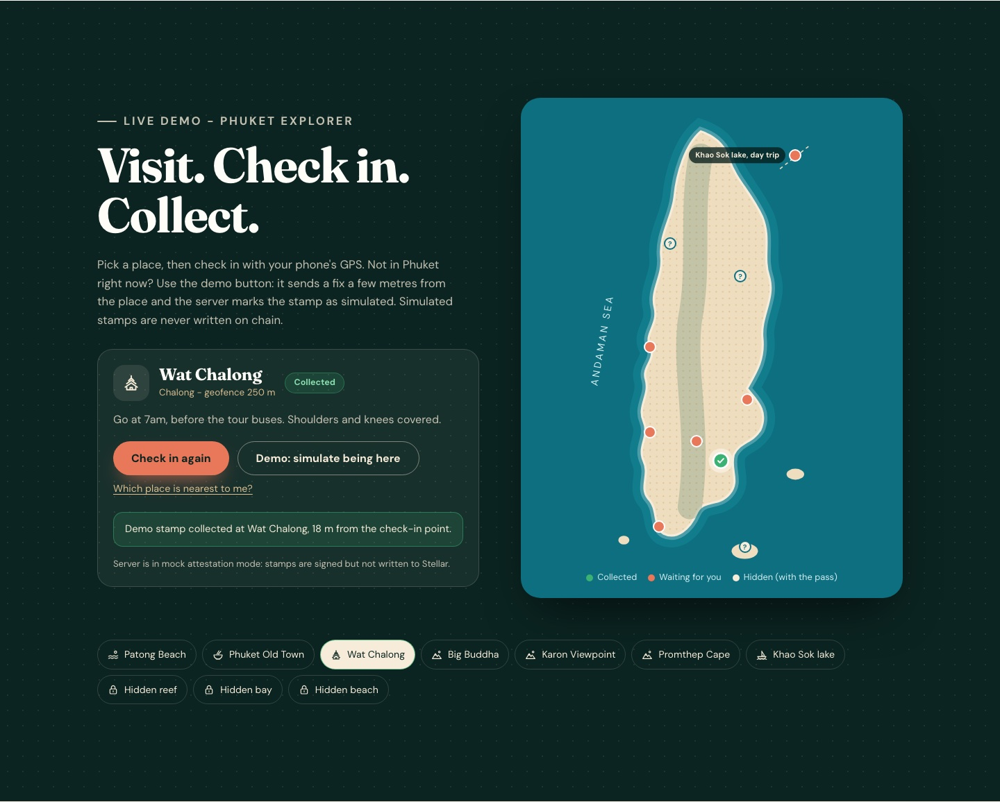
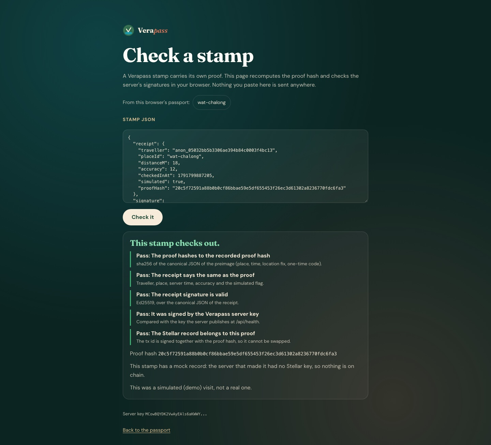
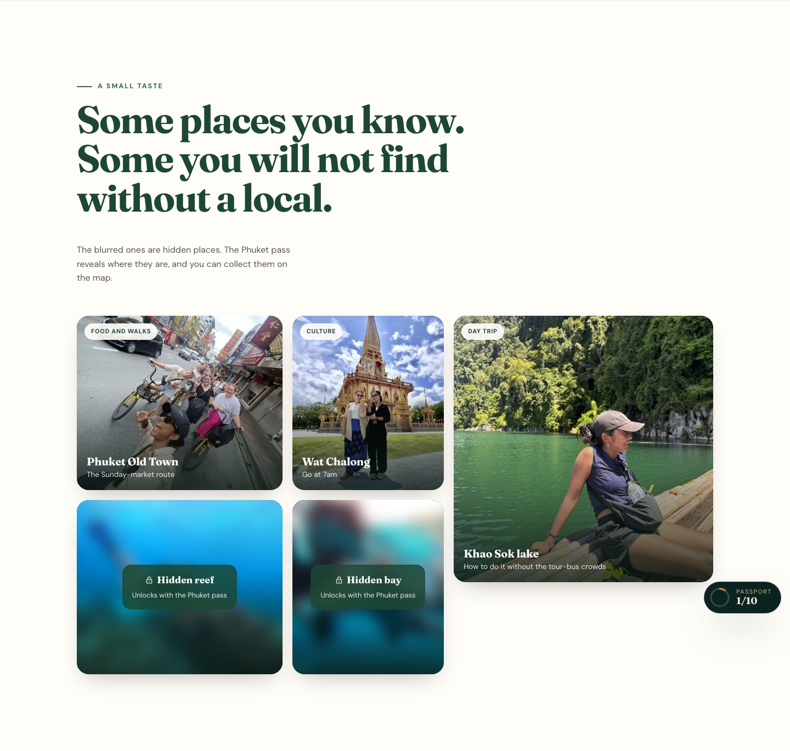
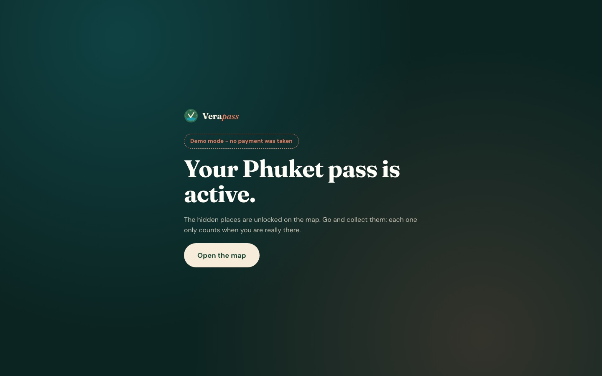
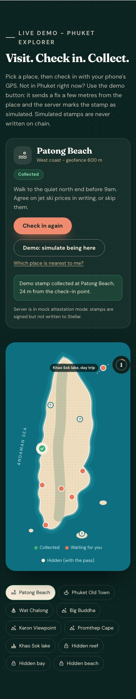

# UI and flows

The web app as it runs today, in demo mode. These screenshots were taken on 2026-10-12 from a local production build (`vite build`) with the API in demo mode: no Stripe or Stellar keys, mock attestation, state in memory. The motion was turned off (`prefers-reduced-motion: reduce`) so each screen is in its final state. Nothing here is a mock-up: every screen is the shipped code, and you can reproduce them with the [quickstart](quickstart.md).

The hidden places stay locked in every screenshot. Their names, coordinates and tips are only in `server/places.ts` and are never sent to a browser without a paid pass, so none of them appear on this page.

Related pages: [architecture](architecture.md) for what happens behind each screen, [API reference](api-reference.md) for the calls each one makes.

## The flow in one line

Open the page, pick a place, check in (GPS on site, or the demo button anywhere), watch the stamp land in the passport, open "Check this stamp" to verify it in the browser, and optionally buy the Phuket pass to unlock the hidden places.

## 1. Home page

The hero states the claim and offers two paths: try a check-in, or get the pass. The card on the right is the intro animation's final frame: a real photo of the guide with the three checks (licensed guide, on location, signed record). The passport counter in the corner (`src/components/PassportDock.tsx`) shows stamps collected out of the 10 places.

Code: `src/sections/Hero.tsx`, `src/components/Nav.tsx`.

## 2. Check in at a place

1. Pick a place from the list under the map (the list is the keyboard path; the pins are a pointer shortcut).
2. "Check in with my GPS" reads the Geolocation API and sends the fix to `POST /api/checkin` after getting a one-time code from `POST /api/nonce`.
3. "Demo: simulate being here" sends a fix a few metres from the place. It goes through the same server checks except the travel-speed check, and the stamp is marked simulated.
4. The status line reports the result, with the distance from the check-in point. In this screenshot the server is in mock attestation mode, and the card says so: stamps are signed but not written to Stellar. With the testnet keys set, this line links the Verapass contract on stellar.expert instead, and each real stamp in the passport links its own transaction.

Hidden places show as locked chips and as "?" markers. The markers sit at rough teaser positions that ship in the public bundle (`shared/places.ts`), not at the real check-in points.

Code: `src/sections/MapCheckin.tsx`, `src/lib/checkin.ts` (nonce, check-in and attestation polling), `src/lib/api.ts`.

## 3. Passport

Each filled slot keeps the signed receipt, the proof preimage and the signed Stellar record. The browser checks the signatures against the key the server publishes at `/api/health` before it counts a stamp: an edited stamp shows "Does not verify" and does not count. The slot shows the attestation id, the proof hash, the transaction (here a mock one, "not on chain") and a "Check this stamp" link.

The passport lives in this browser's `localStorage`. From T1 the app reads stamps from the contract instead ([architecture, section 2](architecture.md#2-check-in-to-stamp)).

Code: `src/sections/Passport.tsx`, `src/components/Stamp.tsx`, `src/lib/passport.ts`, `src/lib/verification.ts`.

## 4. Verify a stamp

"Check this stamp" opens `/verify` with the stamp in the URL fragment, which is never sent to a server. The page recomputes the proof hash from the preimage, compares it with the receipt, checks the Ed25519 signatures on the receipt and on the Stellar record, and compares the signing key with the one the server publishes. The receipt carries a pseudonym (`anon_...`), never the traveller id. Anyone can paste a stamp here, or run the same code from `shared/verify.ts` ([verify a check-in receipt](verify-a-receipt.md)).

Code: `src/pages/Verify.tsx`, `src/lib/verifyLink.ts`, `shared/verify.ts`.

## 5. Places and the Phuket pass

Public places show their photo and a one-line tip. Hidden places are blurred and locked until the traveller has a paid pass; `GET /api/places/hidden` hands their details only to that traveller.

"Get the Phuket pass" calls `POST /api/checkout`. With a Stripe test key that is a Stripe Checkout Session; in demo mode the server records a demo pass for this traveller and sends the browser to `/success`, which says no payment was taken. The success page confirms the pass with the server (`GET /api/pass/:id`) and never unlocks anything from the URL alone.

Code: `src/sections/HiddenPlaces.tsx`, `src/sections/Pricing.tsx`, `src/pages/Success.tsx`, `src/pages/Cancel.tsx`.

## 6. On a phone

| Hero | Check-in |
|---|---|
|  |  |

The layout is mobile first. On phones the verified-guide card comes first, and the place card sits above the map. The end-to-end suite checks for no horizontal overflow at 375 px and runs an axe accessibility gate at 1440 and 390 px ([test plan](test-plan.md)).

## Planned UI work

| Tranche | Change |
|---|---|
| T1 | Freighter co-signs each stamp on desktop; the passport reads stamps from the contract, not browser storage |
| T2 | Passkey wallet on phones (no seed phrase, no XLM); rotating on-site QR code at high-value places |
| T3 | Public creator and place lookup page backed by the indexer and read API |

## Reproduce these screenshots

Follow the [quickstart](quickstart.md) to run the app in demo mode, open http://localhost:5173 and walk the flow above. `npm run test:e2e` runs the same flows (check-in, edited stamp, checkout, verify) as automated tests against a fresh build in demo mode.
